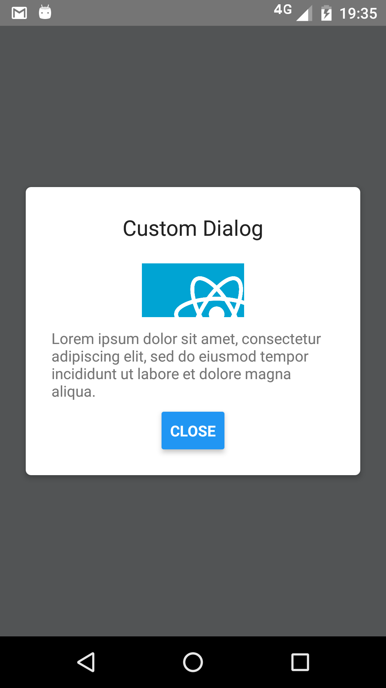
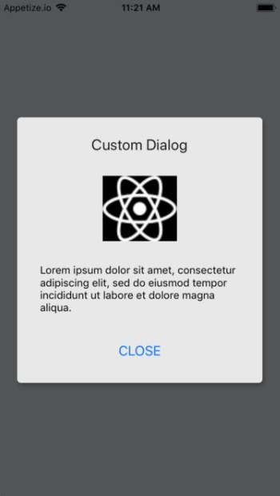
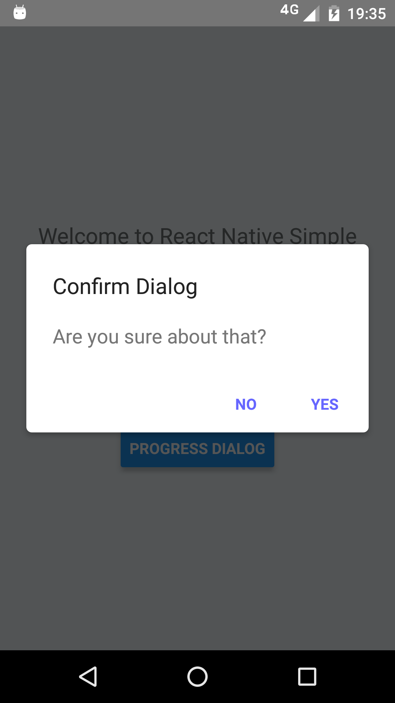
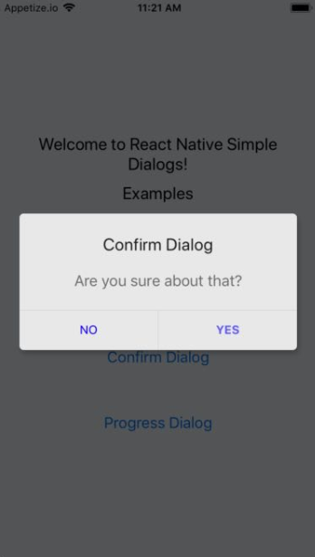
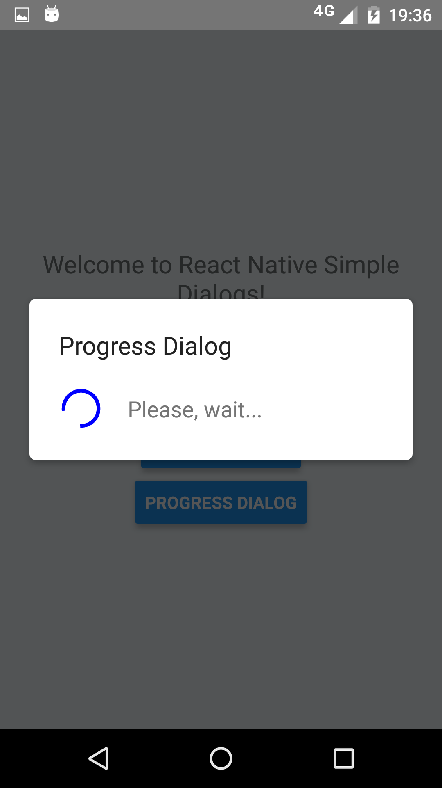
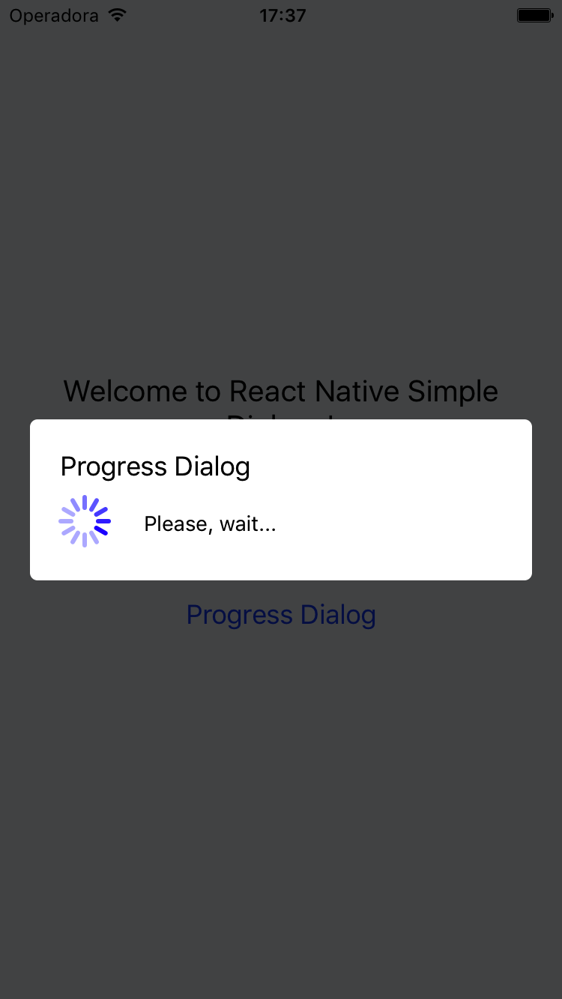

<p align="center">
  
  <br>
  <sub>Cross-platform simple dialogs for React Native based on the native Modal component.</sub>
</p>

<p align="center">
  <b>React Native Simple Dialogs</b> provides flexible, easy-to-use dialogs (<a href="#1-custom-dialog-dialog">Custom</a>, <a href="#2-confirm-dialog-confirmdialog">Confirm</a>, and <a href="#3-progress-dialog-progressdialog">Progress</a>) for React Native with zero native linking, Safe Area support via the safeAreaInsets prop, and platform-tailored aesthetics for Android and iOS.
</p>

<p align="center">
  <a href="LICENSE"></a>
  <a href="https://www.npmjs.com/package/react-native-simple-dialogs"></a>
  <a href="https://www.npmjs.com/package/react-native-simple-dialogs"></a>
  
  = 0.44">
  
  <a href="https://github.com/douglasjunior/react-native-simple-dialogs/pulls"></a>
</p>

<p align="center">
  <a href="#-quick-start"><b>Quick Start</b></a> ·
  <a href="#-why-simple-dialogs">Why</a> ·
  <a href="#-screenshots">Screenshots</a> ·
  <a href="#-compatibility">Compatibility</a> ·
  <a href="#-installation">Installation</a> ·
  <a href="#-usage--examples">Usage</a> ·
  <a href="#-api-reference">API Reference</a> ·
  <a href="#-platform-notes">Platform Notes</a> ·
  <a href="#-contributing">Contributing</a>
</p>

---

## 🚀 Quick Start

```bash
# 1. Install dependency
yarn add react-native-simple-dialogs
# or: npm install --save react-native-simple-dialogs
```

```tsx
import React, { useState } from 'react';
import { Button, View, Text } from 'react-native';
import { ConfirmDialog } from 'react-native-simple-dialogs';

export default function App() {
  const [visible, setVisible] = useState(false);

  return (
    <View style={{ flex: 1, justifyContent: 'center', alignItems: 'center' }}>
      <Button title="Show Confirm Dialog" onPress={() => setVisible(true)} />

      <ConfirmDialog
        title="Confirm Action"
        message="Are you sure you want to proceed?"
        visible={visible}
        onTouchOutside={() => setVisible(false)}
        onRequestClose={() => setVisible(false)}
        positiveButton={{
          title: 'YES',
          onPress: () => {
            setVisible(false);
            alert('Confirmed!');
          },
        }}
        negativeButton={{
          title: 'NO',
          onPress: () => setVisible(false),
        }}
      />
    </View>
  );
}
```

---

## 💡 Why Simple Dialogs?

- ⚛️ **Pure React Native.** Built on top of React Native's built-in `Modal` and `ActivityIndicator`. Zero native pods, zero linking errors, zero native compilation hassles.
- 📱 **Cross-Platform Elegance.** Automatically adapts to platform conventions: Material Design elevation and uppercase action styling on Android, and clean Cupertino styling on iOS.
- 🎛️ **3 Ready-to-Use Dialog Types.** Ships with `Dialog` (fully custom content & buttons), `ConfirmDialog` (message prompt with positive/negative actions), and `ProgressDialog` (loading indicator).
- 🛡️ **Safe Area Insets Support.** Accepts a `safeAreaInsets` prop compatible with [`react-native-safe-area-context`](https://github.com/AppAndFlow/react-native-safe-area-context) to cleanly avoid notches, status bars, and home indicators.
- 👆 **Backdrop & Hardware Back Dismiss.** Effortless dismissal via `onTouchOutside` taps and native Android hardware back button events (`onRequestClose`).
- 🎨 **Deep Styling Freedom.** Fine-grained control over title, message, dialog card, buttons container, and backdrop overlay styles.
- ⌨️ **Keyboard-Friendly Scrolling.** Forwards `keyboardDismissMode` and `keyboardShouldPersistTaps` to the dialog's `ScrollView`, for dialogs with form inputs.
- 📘 **First-Class TypeScript.** Bundled with strict TypeScript definitions and IntelliSense documentation for all props.

---

## 📸 Screenshots

| Dialog Type | Android | iOS |
|:---|:---:|:---:|
| **Custom Dialog** |  |  |
| **Confirm Dialog** |  |  |
| **Progress Dialog** |  |  |

### 🌐 Live Interactive Demo
Try the dialogs directly in your browser or device using the [Expo Snack Example](https://snack.expo.io/@douglasjunior/react-native-simple-dialogs-example).

---

## 📋 Compatibility

| React Native Version | Recommended Library Version | Notes |
|:---|:---|:---|
| `RN >= 0.58.0` | `react-native-simple-dialogs@latest` (`^3.0.0`) | TypeScript support, safe area insets |
| `RN 0.56.0 ... 0.57.8` | `react-native-simple-dialogs@1.0.0` | Legacy compatibility |
| `RN 0.44.0 ... 0.55.4` | `react-native-simple-dialogs@0.3.1` | Initial release line |

---

## 📦 Installation

Add the library to your project dependencies:

```bash
# Using Yarn
yarn add react-native-simple-dialogs

# Using npm
npm install --save react-native-simple-dialogs
```

> [!NOTE]
> Because `react-native-simple-dialogs` is implemented entirely in TypeScript / JavaScript over React Native core components, **no native linking or `pod install` step is required**. It works seamlessly with both Expo (Managed & Bare workflows) and standard React Native CLI projects.

---

## 🛠 Usage & Examples

### 1. Custom Dialog (`Dialog`)

Render arbitrary React elements inside the dialog body, with optional header title and action buttons:

```tsx
import React, { useState } from 'react';
import { View, Text, Button, StyleSheet } from 'react-native';
import { Dialog } from 'react-native-simple-dialogs';

export function CustomDialogExample() {
  const [dialogVisible, setDialogVisible] = useState(false);

  return (
    <View>
      <Button title="Open Custom Dialog" onPress={() => setDialogVisible(true)} />

      <Dialog
        visible={dialogVisible}
        title="Custom Dialog"
        onTouchOutside={() => setDialogVisible(false)}
        onRequestClose={() => setDialogVisible(false)}
        animationType="fade"
        buttons={
          <View style={styles.buttonRow}>
            <Button title="DISMISS" onPress={() => setDialogVisible(false)} />
          </View>
        }
      >
        <View style={styles.dialogContent}>
          <Text style={styles.contentText}>
            This is custom dialog content! You can render any React Native component hierarchy here.
          </Text>
        </View>
      </Dialog>
    </View>
  );
}

const styles = StyleSheet.create({
  buttonRow: {
    flexDirection: 'row',
    justifyContent: 'flex-end',
    padding: 8,
  },
  dialogContent: {
    paddingVertical: 12,
  },
  contentText: {
    fontSize: 16,
    color: '#333333',
  },
});
```

---

### 2. Confirm Dialog (`ConfirmDialog`)

#### With Message Prompt:

```tsx
import React, { useState } from 'react';
import { View, Button } from 'react-native';
import { ConfirmDialog } from 'react-native-simple-dialogs';

export function ConfirmMessageExample() {
  const [dialogVisible, setDialogVisible] = useState(false);

  return (
    <View>
      <Button title="Open Confirm" onPress={() => setDialogVisible(true)} />

      <ConfirmDialog
        title="Delete Item"
        message="Are you sure you want to delete this record? This action cannot be undone."
        visible={dialogVisible}
        onTouchOutside={() => setDialogVisible(false)}
        onRequestClose={() => setDialogVisible(false)}
        positiveButton={{
          title: 'YES',
          onPress: () => {
            setDialogVisible(false);
            console.log('Action confirmed');
          },
        }}
        negativeButton={{
          title: 'NO',
          onPress: () => setDialogVisible(false),
        }}
      />
    </View>
  );
}
```

#### With Custom Content:

`ConfirmDialog` also accepts `children`, allowing you to embed complex custom views while retaining the standardized positive and negative button bar:

```tsx
import React, { useState } from 'react';
import { View, Text, TextInput, Button } from 'react-native';
import { ConfirmDialog } from 'react-native-simple-dialogs';

export function ConfirmCustomContentExample() {
  const [dialogVisible, setDialogVisible] = useState(false);
  const [inputVal, setInputVal] = useState('');

  return (
    <View>
      <Button title="Prompt Dialog" onPress={() => setDialogVisible(true)} />

      <ConfirmDialog
        title="Quick Feedback"
        visible={dialogVisible}
        onTouchOutside={() => setDialogVisible(false)}
        onRequestClose={() => setDialogVisible(false)}
        positiveButton={{
          title: 'SUBMIT',
          onPress: () => {
            setDialogVisible(false);
            console.log('Submitted:', inputVal);
          },
        }}
        negativeButton={{
          title: 'CANCEL',
          onPress: () => setDialogVisible(false),
        }}
      >
        <View style={{ paddingVertical: 10 }}>
          <Text style={{ marginBottom: 8 }}>Please leave a short comment:</Text>
          <TextInput
            value={inputVal}
            onChangeText={setInputVal}
            placeholder="Type your message..."
            style={{ borderWidth: 1, borderColor: '#ccc', borderRadius: 6, padding: 8 }}
          />
        </View>
      </ConfirmDialog>
    </View>
  );
}
```

---

### 3. Progress Dialog (`ProgressDialog`)

Displays a modal loading indicator alongside a descriptive message:

```tsx
import React, { useState } from 'react';
import { View, Button } from 'react-native';
import { ProgressDialog } from 'react-native-simple-dialogs';

export function ProgressDialogExample() {
  const [loading, setLoading] = useState(false);

  const handleStartTask = () => {
    setLoading(true);
    setTimeout(() => {
      setLoading(false);
    }, 3000);
  };

  return (
    <View>
      <Button title="Start Async Task" onPress={handleStartTask} />

      <ProgressDialog
        visible={loading}
        title="Processing"
        message="Please, wait..."
        activityIndicatorColor="#3fd0ff"
        activityIndicatorSize="large"
      />
    </View>
  );
}
```

---

### 4. Handling Safe Area Insets

Due to the deprecation of React Native's legacy `SafeAreaView`, `Dialog` supports a `safeAreaInsets` prop to guarantee appropriate padding around notches, dynamic islands, status bars, and home indicators.

You can combine it with [`react-native-safe-area-context`](https://github.com/AppAndFlow/react-native-safe-area-context):

```tsx
import React, { useState } from 'react';
import { View, Text } from 'react-native';
import { useSafeAreaInsets } from 'react-native-safe-area-context';
import { Dialog } from 'react-native-simple-dialogs';

export function SafeAreaDialogExample() {
  const [visible, setVisible] = useState(true);
  const insets = useSafeAreaInsets();

  return (
    <Dialog
      visible={visible}
      title="Safe Area Aware"
      safeAreaInsets={insets}
      onTouchOutside={() => setVisible(false)}
      onRequestClose={() => setVisible(false)}
    >
      <View>
        <Text>This dialog respects device insets and notches cleanly.</Text>
      </View>
    </Dialog>
  );
}
```

See the complete runnable implementation in the [Sample project](https://github.com/douglasjunior/react-native-simple-dialogs/blob/master/Sample/src/App.tsx).

---

## 📖 API Reference

### `<Dialog>` Props

The base dialog component upon which `ConfirmDialog` and `ProgressDialog` are built.

| Prop | Type | Default | Description |
|:---|:---|:---|:---|
| `visible` | `boolean` | `false` | Controls modal visibility. |
| `onRequestClose` | `() => void` | `() => null` | Callback invoked when the user presses the Android hardware back button. |
| `animationType` | `'none' \| 'slide' \| 'fade'` | `'none'` | Controls how the modal transition animates. |
| `onShow` | `() => void` | `undefined` | Callback invoked once the modal is fully displayed. |
| `onTouchOutside` | `() => void` | `undefined` | Callback invoked when the user taps the overlay outside the dialog box. |
| `children` | `React.ReactNode` | `undefined` | Custom content elements rendered inside the dialog body. |
| `title` | `string` | `undefined` | Modal title text displayed at the top. |
| `titleStyle` | `StyleProp<TextStyle>` | `undefined` | Custom style applied to the title text. |
| `dialogStyle` | `StyleProp<ViewStyle>` | `undefined` | Custom style applied to the dialog card container. |
| `contentStyle` | `StyleProp<ViewStyle>` | `undefined` | Custom style applied to the dialog body content wrapper. |
| `buttonsStyle` | `StyleProp<ViewStyle>` | `undefined` | Custom style applied to the buttons container wrapper. |
| `overlayStyle` | `StyleProp<ViewStyle>` | `undefined` | Custom style applied to the full-screen backdrop overlay. |
| `buttons` | `React.ReactNode` | `undefined` | Custom button element(s) rendered at the bottom of the dialog. |
| `safeAreaInsets` | `EdgeInsets` | `undefined` | Inset offsets `{ top, bottom, left, right }` to avoid notches and status bars. |
| `supportedOrientations` | `ModalProps['supportedOrientations']` | `['portrait']` | Supported orientations on iOS (e.g. `'portrait'`, `'landscape'`). |
| `onOrientationChange` | `() => void` | `undefined` | iOS callback triggered on device orientation changes while the dialog is visible. |
| `statusBarTranslucent` | `boolean` | `undefined` | Android: Determines whether the modal backdrop extends underneath the system status bar. |
| `keyboardDismissMode` | `'none' \| 'on-drag' \| 'interactive'` | `undefined` | Determines whether the keyboard is dismissed in response to a drag. |
| `keyboardShouldPersistTaps` | `'always' \| 'never' \| 'handled' \| boolean` | `undefined` | Controls whether the keyboard stays visible after tapping inside the dialog scroll view. |
| `contentInsetAdjustmentBehavior` | `ScrollViewProps['contentInsetAdjustmentBehavior']` | `'never'` | Specifies how safe area insets modify the scroll area. |
| `testID` | `string` | `undefined` | Test identifier used to locate the dialog in end-to-end testing suites. |
| `accessible` | `boolean` | `undefined` | Indicates whether the dialog view is an accessibility element. |
| `accessibilityLabel` | `string` | `undefined` | Overrides the text read by screen readers. |
| accessibility* / `role` | `ModalProps` | `undefined` | Additional accessibility props (`accessibilityActions`, `accessibilityRole`, `accessibilityState`, `accessibilityHint`, `accessibilityValue`, `onAccessibilityAction`, `importantForAccessibility`, `role`) forwarded directly to `Modal`. |

---

### `<ConfirmDialog>` Props

Inherits all props from [`<Dialog>`](#dialog-props) except `buttons` (which `ConfirmDialog` renders itself from `positiveButton` and `negativeButton`), plus:

| Prop | Type | Default | Description |
|:---|:---|:---|:---|
| `positiveButton` | `ConfirmDialogButtonPropsType` | **REQUIRED** | Configuration object for the primary / positive action button. |
| `negativeButton` | `ConfirmDialogButtonPropsType` | `undefined` | Optional configuration object for the secondary / cancel action button. |
| `message` | `string` | `undefined` | Message text displayed in the body of the confirm dialog. |
| `messageStyle` | `StyleProp<TextStyle>` | `undefined` | Custom style applied to the message text. |

#### `ConfirmDialogButtonPropsType` Shape

| Field | Type | Default | Description |
|:---|:---|:---|:---|
| `title` | `string` | **REQUIRED** | Button text label. |
| `onPress` | `() => void` | **REQUIRED** | Callback triggered when the button is pressed. |
| `disabled` | `boolean` | `false` | Disables button interactions when `true`. |
| `titleStyle` | `StyleProp<TextStyle & { colorDisabled?: string }>` | `undefined` | Custom text styling, with optional `colorDisabled`. |
| `style` | `StyleProp<ViewStyle & { backgroundColorDisabled?: string }>` | `undefined` | Custom button view styling, with optional `backgroundColorDisabled`. |

---

### `<ProgressDialog>` Props

Inherits all props from [`<Dialog>`](#dialog-props), plus:

| Prop | Type | Default | Description |
|:---|:---|:---|:---|
| `message` | `React.ReactNode` | `undefined` | Text or node displayed alongside the activity indicator. |
| `messageStyle` | `StyleProp<TextStyle>` | `undefined` | Custom text style applied to the message. |
| `activityIndicatorColor` | `ColorValue` | `undefined` | Tint color of the activity indicator spinner. |
| `activityIndicatorSize` | `'small' \| 'large' \| number` | `undefined` | Size of the activity indicator. *(Numeric size is supported on Android only)*. |
| `activityIndicatorStyle` | `StyleProp<ViewStyle>` | `undefined` | Custom style applied directly to the `ActivityIndicator`. |

---

### `EdgeInsets` Shape

Used by `safeAreaInsets` to calculate boundary padding:

```ts
interface EdgeInsets {
  top: number;
  right: number;
  bottom: number;
  left: number;
}
```

---

## 📱 Platform Notes

- **Android Hardware Back Button:** Always pass `onRequestClose`; its default is a no-op, so the back button does nothing otherwise. `onTouchOutside` only handles taps on the backdrop.
- **Translucent Status Bar (Android):** When your application uses a translucent status bar, supply `statusBarTranslucent={true}` to ensure the overlay backdrop dims the entire screen seamlessly.
- **Orientation Changes (iOS):** When supporting multiple device orientations on iOS, configure `supportedOrientations={['portrait', 'landscape']}` and optionally attach an `onOrientationChange` callback.
- **Expo Friendly:** Zero native code means `react-native-simple-dialogs` works out-of-the-box in Expo Go and EAS Build without custom native dev clients.

---

## 🤝 Contributing

Bug fixes, improvements, and documentation suggestions are welcome!

1. Fork the repository and create your topic branch (`git checkout -b feature/my-feature`).
2. Verify code quality with TypeScript build and lint checks (`yarn build` and `npx eslint src`).
3. Commit your changes using [Conventional Commits](https://www.conventionalcommits.org/).
4. Push to your branch and open a descriptive Pull Request.

For questions, bug reports, and feature proposals, please open an [issue](https://github.com/douglasjunior/react-native-simple-dialogs/issues).

### Support the Author

If this library saved you development time, consider supporting the maintainer:

<p align="left">
  <a href="https://www.patreon.com/douglasjunior"></a>
  &nbsp;
  <a href="https://paypal.me/douglasnassif"></a>
</p>

---

## ⭐ Star History

<p align="center">
  <a href="https://star-history.com/#douglasjunior/react-native-simple-dialogs&Date">
    <picture>
      <source media="(prefers-color-scheme: dark)" srcset="https://api.star-history.com/svg?repos=douglasjunior/react-native-simple-dialogs&type=Date&theme=dark" />
      
    </picture>
  </a>
</p>

---

## 📄 License

```text
The MIT License (MIT)

Copyright (c) 2017 Douglas Nassif Roma Junior
```

See the full [license file](LICENSE).

---

## 🌐 Author & More Projects

<p align="center">
  <a href="https://douglasjunior.work">
    
  </a>
</p>

<p align="center">
  Discover more open-source libraries, creative animation engines, and developer tools at <a href="https://douglasjunior.work"><b>douglasjunior.work</b></a>.
</p>
